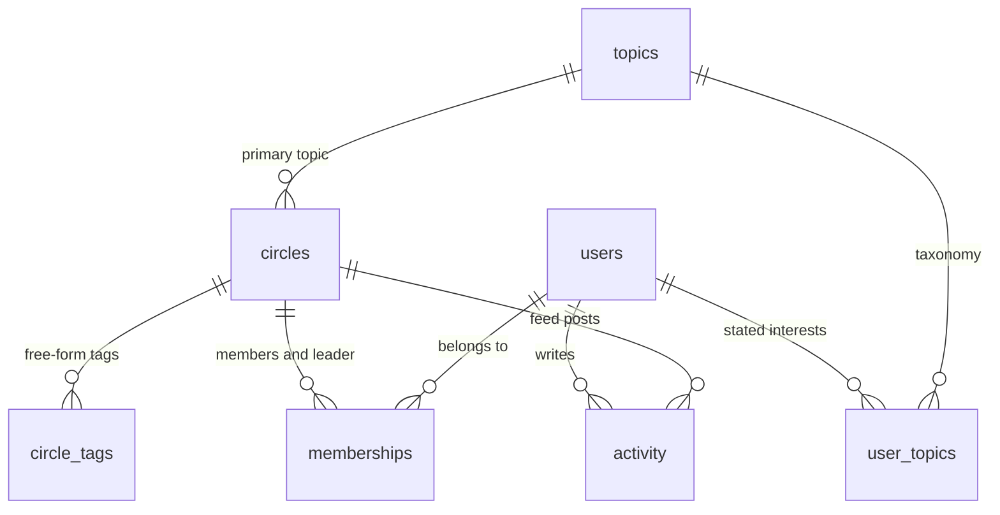

# Database schema

SQLite. [app/schema.sql](../app/schema.sql) defines it and [app/seed.py](../app/seed.py) loads it from `data/`. `make seed` rebuilds it, and the API seeds it on first start.

## Tables

| Table | One row per | Notes |
|---|---|---|
| topics | Taxonomy topic | `slug` is unique, and it's what other tables reference. |
| users | Member | Bio, job title, company, industry and location can be null. `has_photo` is 0 or 1. |
| user_topics | Member and stated interest | Primary key `(user_id, topic_slug)`. `topic_slug` references topics. |
| circles | Circle | `topic` can be null. A null `max_members` means uncapped. |
| circle_tags | Circle and tag | Primary key `(circle_id, tag_slug)`. No foreign key on `tag_slug`. |
| memberships | Member of a Circle | Primary key `(user_id, circle_id)`. `role` is member or leader. |
| activity | Feed post | Reaction, comment and save counts per post. |

## Decisions

- **Join tables instead of JSON columns** for interests and tags. Matching by topic becomes an indexed lookup, and stated interests are checked against the taxonomy.
- **Constraints wherever the data has rules.** Foreign keys cover every reference except free-form tags. CHECK constraints cover the fixed values: format, access, join policy, role, `has_photo` and `profile_completeness`. Deleting a Circle removes its memberships, tags and posts. Deleting a user removes their memberships and interests.
- **Tags are free-form.** The dataset README calls them "free-form topic-ish tags", so `circle_tags.tag_slug` has no foreign key to topics. Seeding trims, lowercases and deduplicates them, because circle 17 lists one tag twice.
- **Derived signals are computed, not stored.** Whether a Circle is full, how long it's been idle, its leader's location and its 30-day activity are computed when the catalog is built in [app/models.py](../app/models.py). Stored copies would go stale.

## Indexes

| Index | Serves |
|---|---|
| memberships primary key `(user_id, circle_id)` | A member's Circles. Lookups by `user_id` use the key's leading column. |
| `idx_memberships_circle_id` | A Circle's members and leader. |
| `idx_activity_circle_time (circle_id, created_at)` | A Circle's posts inside the 30-day window. |
| `idx_circles_topic` | Circles on a topic. |
| `idx_circle_tags_tag_slug` | Circles carrying a tag. |
| user_topics and circle_tags primary keys | A member's interests, and a Circle's tags. |

**No separate index on `memberships(user_id)`.** The primary key's index is sorted by `user_id` first. Like a phone book sorted by last name and then first name, it already finds every row for one user. A second index would cost disk space and write time without speeding up any read. A test checks SQLite's query plan, so the decision can't silently regress.

## In production

- Postgres, with tags in an array column under a GIN index, or a tags table as here.
- A materialized Circle-features table refreshed by a job or from events, instead of computing features at startup.
- Activity partitioned by month, since it grows without bound.
- A real location field on Circles with a geo index, instead of the leader's city.
